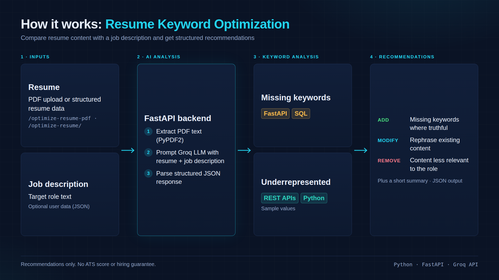
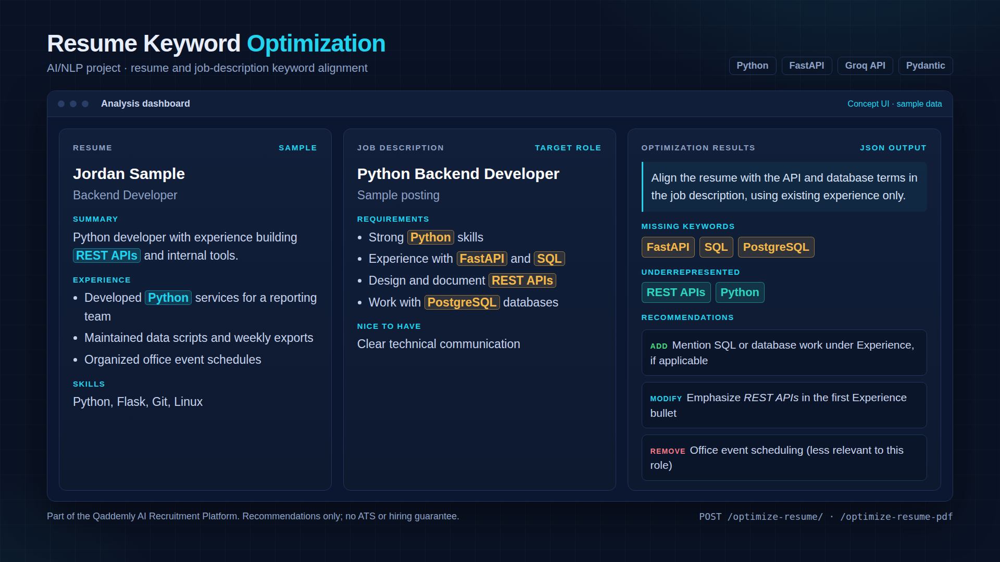

# Resume Keyword Optimization

An AI-assisted resume analysis API that compares resume content with a target job description and returns structured, actionable recommendations.

> Portfolio showcase: this module is part of the Qaddemly AI Recruitment Platform. It focuses on resume keyword analysis and content-alignment recommendations; it does not guarantee ATS ranking or interview outcomes.

## Visual Overview

### Resume Keyword Optimization Workflow

This diagram illustrates the intended workflow from resume input and job description to keyword analysis and actionable recommendations.



### Portfolio Preview

The following visual is a conceptual portfolio showcase of the resume keyword optimization use case.



## Features

- Accept structured resume data and a target job description.
- Accept a resume PDF and extract its text for analysis.
- Identify missing and underrepresented keywords from the job description.
- Return recommendations grouped into `add`, `modify`, and `remove`.
- Return a structured JSON response for integration with other applications.

## Tech Stack

- Python
- FastAPI
- Groq API (LLM inference)
- Pydantic
- PyPDF2
- python-dotenv

## API Endpoints

| Method | Endpoint | Purpose |
|---|---|---|
| POST | `/optimize-resume/` | Analyze structured resume data against a job description |
| POST | `/optimize-resume-pdf` | Extract text from a PDF resume and analyze it against a job description |

Interactive API documentation is available at `/docs` when the server is running locally.

## Setup

1. Create and activate a Python virtual environment.
2. Install dependencies:

   ```bash
   pip install -r requirements.txt
   ```

3. Copy `.env.example` to `.env` and add your own Groq API key:

   ```env
   GROQ_API_KEY=your_groq_api_key_here
   ```

4. Start the API:

   ```bash
   uvicorn main:app --reload --port 8006
   ```

5. Open [http://127.0.0.1:8006/docs](http://127.0.0.1:8006/docs).

## Example Request

For `POST /optimize-resume/`:

```json
{
  "userData": {},
  "resumeData": {
    "raw_text": "Python developer with experience building REST APIs..."
  },
  "jobDescription": "Seeking a Python developer with FastAPI and SQL experience..."
}
```

## Response Structure

The API is designed to return a JSON object with these top-level fields:

- `summary`
- `recommendations.add`
- `recommendations.modify`
- `recommendations.remove`
- `keyword_analysis.missing_keywords`
- `keyword_analysis.underrepresented_keywords`

## Important Notes

- Recommendations must reflect the candidate's real experience and qualifications; do not invent skills, achievements, or employment history.
- PDF text extraction quality depends on the PDF. Scanned/image-only PDFs may require OCR, which is not included in the current implementation.
- Keep API keys in environment variables and never commit a real `.env` file.
- This project provides recommendations only and does not certify ATS compatibility or guarantee hiring outcomes.

## Project Context

This module was developed as part of the Qaddemly AI Recruitment Platform. This repository is intended as a portfolio showcase of the resume keyword optimization component. Reuse or redistribution of the original project source should follow the permissions and licensing terms of the original project.
